<picture>
  <source media="(prefers-color-scheme: dark)" srcset="assets/banner-dark.svg">
  <source media="(prefers-color-scheme: light)" srcset="assets/banner-light.svg">
  
</picture>

I'm **Tengiz Kiknadze**, a Senior iOS Developer in Tbilisi, Georgia. I've spent 6 years building iOS apps in Swift, SwiftUI and UIKit: a live crypto trading app, match-day dashboards for professional sports clubs and a vertical video feed for a social startup.

Plenty of people start apps. I have a habit of finishing them.

Right now most of my hours go to backend, security and infrastructure on a live crypto exchange. It is the heaviest work I've done so far. Real money has a way of sharpening your code review.

That's the short version. [The long version](https://github.com/BoogieManN8/BoogieManN8/blob/main/ABOUT.md) has the full history, the stack and how I work.

## Open source

- [Networking](https://github.com/BoogieManN8/Networking) is a small Swift networking layer on URLSession and async/await. It has typed endpoints, a WebSocket client that lives in an actor and reconnects by itself, and zero dependencies.
- [CustomRouting](https://github.com/BoogieManN8/CustomRouting) is a SwiftUI router that puts screens, alerts and modals behind one protocol.

Most of my commits sit in private repositories under NDA. What you see on this profile is the trailer.

## Stack

| Area | What I use |
|:--|:--|
| Every day | Swift, SwiftUI, UIKit, Swift Concurrency, Combine |
| Architecture | VIPER, RIBs, TCA, MVVM-C, Clean Architecture, TDD |
| Frameworks | StoreKit 2, AVFoundation, CloudKit, SwiftData, Core ML, Vision, WidgetKit |
| Around the app | XCTest, Fastlane, GitHub Actions, REST, WebSockets, Firebase |

I've also led UIKit to SwiftUI migrations on production apps. Nobody misses the storyboards.

## Get in touch

I'm open to senior iOS roles, remote or in Europe. Relocation is fine. I pack light.

Email is the quickest way to reach me: [tengizkiknadze8@gmail.com](mailto:tengizkiknadze8@gmail.com)

